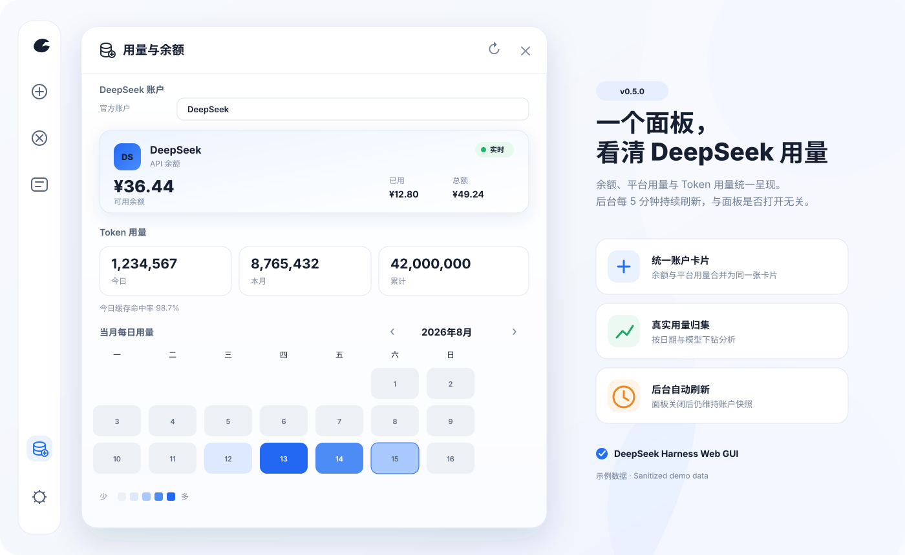

# dsh-usage-stats

[](https://github.com/ray19156014597/dsh-usage-stats/releases/latest)
[](https://github.com/ray19156014597/dsh-usage-stats/actions/workflows/ci.yml)
[](LICENSE)

为 [DeepSeek Harness](https://github.com/deepseek-ai/deepseek-harness) 网页端提供 DeepSeek 账户余额、平台用量与 Token 用量分析。

DeepSeek balance, platform usage, and token-usage analytics for the DeepSeek Harness Web GUI (`dsh web`).



> 展示图使用脱敏演示数据；插件不会把 API Key、Cookie、用量 Token 或上游原始响应发送到浏览器。

## 致谢 / Credits

本项目基于 [Ychris12138/dsh-usage-stats](https://github.com/Ychris12138/dsh-usage-stats)
（MIT，原插件基座）开发；DeepSeek 平台用量接口与「网页登录自动同步」移植自
[Joyi-code/DeepSeekMonitorWindows](https://github.com/Joyi-code/DeepSeekMonitorWindows)
（MIT）；功能设计启发自
[JayHome137/DeepSeekMonitor](https://github.com/JayHome137/DeepSeekMonitor)（macOS 原创版）。

开发过程中使用 [OpenCLI](https://github.com/opencode-ai/opencli) 辅助探测与优化平台
用量接口的参数细节。

> 本插件为非 DeepSeek 官方产品，与 DeepSeek 官方无关，仅用于学习与研究目的；平台接口可能随官方调整而变化，
> 不保证长期可用。API Key 与用量 Token 属于敏感凭据，请自行妥善保管。

## 一眼看懂 / At a glance

| | 能力 | 说明 |
| --- | --- | --- |
| 💳 | 账户卡片 | DeepSeek 余额与平台用量合并为**同一张卡**，一次呈现账户全貌 |
| 📈 | DeepSeek 平台用量 | 本月/今日消费、按模型、**按 API Key** 的 Token/请求/缓存命中/费用明细（需网页用量 Token）；每日用量与本地一致地按 **GMT+8** 展示，位于 Token 用量模块之前 |
| 📊 | Token 用量分析 | 今日、本月、累计、缓存命中率、月历热图，以及按日期/模型下钻 |
| 🔄 | 后台刷新 | 服务端启动即刷新，之后每五分钟更新余额与本地 Token 聚合 |
| ⌨️ | 顺手交互 | 面板自徽标处展开、关闭带退场动效；`Esc` 逐级返回；刷新按钮转圈并把“更新于 hh:mm”换成“刷新中…”；首屏加载用骨架占位；浅色/深色跟随 Harness 主题偏好 |
| 🔒 | 本机安全边界 | 七个端点仅接受回环请求；凭据只在服务端解析并发往校验后的 DeepSeek 地址 |

界面支持中文和英文。浏览器只请求 DeepSeek 账户与本地聚合数据；后台刷新与面板是否打开无关。手动刷新会更新 Token 用量、余额与平台用量。动效遵守系统的“减少动态效果”设置，键盘焦点环与 ARIA 标签齐备。

## 快速安装 / Quick start

需要 DeepSeek Harness `web` profile（`@deepseek-ai/dsh >= 0.1.0-rc.6`）。

```bash
dsh plugin --profile web add "github:ray19156014597/dsh-usage-stats"
```

然后重启已经运行的 `dsh web`，并在浏览器中硬刷新。侧边栏底部会出现“用量/余额”（Usage/Balance）入口。

升级或卸载：

```bash
dsh plugin --profile web update dsh-usage-stats
dsh plugin --profile web remove dsh-usage-stats
```

<details>
<summary><strong>兼容安装器：无法使用 dsh plugin 时展开</strong></summary>

PowerShell、命令提示符和 macOS/Linux 终端使用同一条命令：

```bash
npx --yes github:ray19156014597/dsh-usage-stats
```

安装器会把运行文件复制到 `~/.dsh/profiles/node_modules/dsh-usage-stats`，并在 `profiles/web/cordis.patch.yml` 中幂等启用插件。重复运行即可更新，不会重复追加配置。设置了 `DSH_HOME` 时使用该目录。

`dsh plugin` 与 `npx` 是两条独立安装路径，请选择其中一种；不要同时保留手工 Cordis entry 和 bundle 注册，否则会重复挂载。

```bash
# 预览，不修改文件
npx --yes github:ray19156014597/dsh-usage-stats --dry-run

# 检查现有安装
npx --yes github:ray19156014597/dsh-usage-stats --check

# 安装但不修改 Cordis patch
npx --yes github:ray19156014597/dsh-usage-stats --no-enable
```

无法使用 `npx` 时可从源码运行 `node scripts/install.mjs`。

</details>

## 支持的账户类型 / Providers

插件只对接 DeepSeek 官方账户：余额查询需要 API Key，Token 用量统计不需要额外凭据。账户查询使用唯一适配器 `deepseek-balance`。

| Provider / adapter | 模式 | 默认凭据 | 上游接口 |
| --- | --- | --- | --- |
| DeepSeek | 余额 | `llm-deepseek` 的 `apiKeyEnv`（默认 `DEEPSEEK_API_KEY`） | `/user/balance` |

未配置 API Key 时账户卡片显示“未配置”，不会猜测余额；Token 用量统计不受影响。

## 凭据与配置 / Configuration

凭据由 Harness 从 `~/.dsh/.credentials.yaml` 解析。安装器不会读取、创建或修改该文件。不要把真实 Key、Cookie 或用量 Token 提交到 Git、公开 issue，或粘贴给编码 Agent。

插件的连接信息读取 Harness 的 `llm-deepseek` settings 命名空间（API Key 引用与 base URL），缺失时回退到 `DEEPSEEK_API_KEY` 与 `https://api.deepseek.com`。Cordis config 只接受一个字段 `usageTokenRef`（平台用量 Token 的凭据引用，默认 `DEEPSEEK_USAGE_TOKEN`）。

### DeepSeek 余额

```yaml
# ~/.dsh/.credentials.yaml
DEEPSEEK_API_KEY: sk-your-key-here
```

余额来自 `GET /user/balance`，账户卡片显示剩余额度、已用与总额度，并按剩余比例给出 `normal / warning / critical` 状态（默认 30% / 10%）。服务端启动即查询，之后每五分钟刷新一次。

### DeepSeek 平台用量（余额之外的消费与 Token 明细）

DeepSeek 官方只公开余额接口，没有账户级用量 API。插件移植了
[DeepSeekMonitorWindows](https://github.com/Joyi-code/DeepSeekMonitorWindows)
的方案：用量数据来自 `platform.deepseek.com` 的网页接口
（`/api/v0/usage/by_api_key/amount` 与 `/api/v0/usage/by_api_key/cost`），需要**用量 Token**——
它与 API Key 不同，是登录 platform.deepseek.com 后在控制台执行
`JSON.parse(localStorage.userToken).value` 得到的会话凭据：

```yaml
# ~/.dsh/.credentials.yaml
DEEPSEEK_API_KEY: sk-your-key-here      # 余额接口
DEEPSEEK_USAGE_TOKEN: eyJ...            # 平台用量接口（localStorage.userToken）
```

用量 Token 会过期；查询失败时按上述方式重新获取即可。该 Token 只在服务端
通过 credentials seam 解析，不会进入浏览器响应或插件缓存。自定义引用可在
Cordis config 中设置 `usageTokenRef`。

**也可以在界面里配置**：打开用量面板，点标题栏的 ⚙ 设置按钮（或平台用量
区块未配置提示旁的“配置用量 Token”按钮），两种方式任选：

- **方式一：网页登录自动同步**（推荐，移植自 DeepSeekMonitorWindows）——
  点击后服务端拉起系统 Edge/Chrome 窗口打开 platform.deepseek.com，登录
  成功后自动捕获、验证并保存用量 Token（复用 DSMW 的 fetch/XHR 钩子 +
  `localStorage.userToken` 轮询），随后立即刷新平台用量并显示本月消费。
  登录状态保存在 `~/.dsh/usage-stats/browser-profile`，下次同步无需重新登录。
- **方式二：手动粘贴**——按页面指引在控制台执行
  `JSON.parse(localStorage.userToken).value` 后粘贴保存。

保存/清除后平台用量数据立即同步更新。Token 保存在
`~/.dsh/storages/usage-stats-platform.json`（权限受限），服务端优先使用
credentials 文件中的引用，其次才用面板保存的值。未配置时面板显示获取指引，
不影响其余功能。自动同步依赖本机 Edge/Chrome（CDP，无新增 npm 依赖）；
找不到浏览器时会提示改用方式二。

## 使用 / Usage

1. 点击侧边栏“用量/余额”。
2. 「账户与用量」显示 DeepSeek 账户卡：余额与平台用量合并为**同一张卡**（细分隔线连接）：余额 → 平台用量（月份切换、本月消费、今日消费、API 请求数与按模型明细）。
3. 其下方的「Token 用量」显示今日/本月/累计与缓存命中率，月历热力图在平台用量配置后显示平台获取的每日用量（标题旁标注数据源），未配置时回退显示本地用量，点击日期可下钻当日明细；面板最末尾是**可折叠的「按 API Key」**明细（默认收起，可点击展开/收起）。
4. 使用热图的 `‹` / `›` 切换月份；点击日期查看当天明细：本地日显示 `provider/model` 明细，平台日显示逐小时分布与按 API Key 明细。
5. 标题栏刷新会更新 Token 用量、余额与平台用量。

“最近 14 天”按本地日历计算，只显示窗口内存在用量的日期；未来时间戳不会计入。本地会话用量按 `provider/model` 归集，同一模型经由不同 provider 路由时会分别统计。

## Agent 友好安装 / Agent-friendly installation

<details>
<summary><strong>复制给 Codex、Claude Code 或其他本地编码 Agent</strong></summary>

```text
Install or update dsh-usage-stats from:
https://github.com/ray19156014597/dsh-usage-stats

Constraints:
- Resolve DSH_HOME from the environment; otherwise use ~/.dsh.
- Do not read, print, edit, or request .credentials.yaml, cookies, or any API key.
- Do not expose the plugin through a reverse proxy.
- Do not restart or terminate an existing dsh process without asking me.

Procedure:
1. Confirm node, npx, and dsh are available.
2. Prefer `dsh plugin --profile web update dsh-usage-stats` when already installed; otherwise use `dsh plugin --profile web add "github:ray19156014597/dsh-usage-stats"`.
3. If unavailable, use: npx --yes github:ray19156014597/dsh-usage-stats
4. Do not combine bundle installation with an existing manual dsh-usage-stats Cordis entry.
5. For npx, require a verified package and exactly one Cordis entry, then run again with --check.
6. Report the installation path and resolved profile paths.
7. If dsh web is running, report that a restart is needed and stop.

Optional account setup (never handle secret values yourself):
- DeepSeek balance reuses DEEPSEEK_API_KEY.
- The platform usage token is set through the panel settings page or a usageTokenRef credential reference.
- Never ask me to paste a key, usage token, or browser cookie into chat.
```

只获准检查而不能修改时运行：

```bash
npx --yes github:ray19156014597/dsh-usage-stats --check
```

安装器退出码：未知参数返回 `2`；文件、版本或配置验证失败返回非零；成功时输出已验证版本、安装目录和 patch 路径。Agent 无需自行解析或重写 YAML。

</details>

## 隐私与安全 / Privacy & security

- API Key、Cookie 与用量 Token 不会进入浏览器响应、插件缓存或日志。
- 余额请求固定使用 HTTPS、不跟随重定向，响应体上限为 1 MiB；上游地址禁止内嵌 username/password，凭据只在服务端按 credential ref 注入请求头。
- 余额请求在发凭据前会校验域名的全部 IPv4/IPv6 解析结果并固定连接地址，防止 DNS rebinding 绕过私网限制。唯一例外是 **本地代理的 fake-ip 占位地址**（`198.18.0.0/15`，Clash / Mihomo / Surge / iKuuu 等客户端对所有域名都返回这一段的地址，再按 SNI 自行转发）：它无法指向内网服务，因此按解析结果放行并照常固定连接；但把该地址直接写进配置（`https://198.18.0.5`）仍然拒绝。域名解析到真正的内网地址时按"暂时不可用"处理，保留上一次余额并显示解析结果。
- 七个端点仅接受回环请求，并同时校验 peer socket 与 Host；其中五个只接受 `GET`，`platform/token` 与 `platform/sync` 额外接受 `POST`/`DELETE`。支持 IPv4、IPv4-mapped IPv6 和 `[::1]:port`。
- 用量缓存 `~/.dsh/storages/usage-stats-cache.json` 只保存聚合 Token、会话 id、不透明 revision 与折叠游标，不保存提示词、回复或文件路径。
- DeepSeek 平台用量 Token 只在服务端解析并用于请求 `platform.deepseek.com`，平台用量结果按月份在内存中缓存五分钟，不落盘、不出现在响应中。

本机反向代理会让插件看到代理自身的回环地址。请勿把端点经反向代理暴露到局域网或公网；确需代理时必须在代理层增加可靠认证与访问控制。安全问题请按 [SECURITY.md](SECURITY.md) 私下报告。

## 正确性与数据口径 / Correctness

统计值来自 `assistant/chunk` 或 `assistant/message` 中 provider-reported `usage`，不是本地估算。相同 turn/step 的后续样本会替换旧样本，并按 `provider/model` 归集。

- **时区口径**：平台用量与本地会话用量统一按 **GMT+8** 展示。平台取数使用官网用量页同一套接口（`/api/v0/usage/by_api_key/amount|cost`，`start/end` 为 GMT+8 日的 epoch 秒、`tz=28800`）：月视图按 `bucket=86400` 取每日数据，日视图按 `bucket=3600` 取逐小时数据。若该私有接口异常，自动回退旧的 `usage/amount|cost`（UTC 日、无按 API Key 维度）并保持面板可用（接口响应带 `source` 标记），此时平台日与本地 GMT+8 可能相差一天。
- 活跃会话只处理新追加事件。
- 持久化会话使用不透明 revision；未变化时不重复读取日志。
- seq 缺口、日志重写或 live/persisted 切换时完整重折叠该会话。
- 聚合采用 single-flight，并在同一临界区原子保存缓存。
- `validate:live` 会逐会话比较 raw artifact、`session.history`、插件端点与官方 token projection；缺文件或不一致会返回非零。

## API

| Method | Path | Response |
| --- | --- | --- |
| `GET` | `/api/usage-stats/usage` | 按日期/provider/model 聚合的 Token 与缓存命中率 |
| `GET` | `/api/usage-stats/account?refresh=1` | DeepSeek 余额快照；`refresh=1` 强制刷新上游 |
| `GET` | `/api/usage-stats/platform?month=&year=&refresh=` | DeepSeek 平台用量（模型/按日 Token 明细与消费）；`refresh=1` 强制刷新 |
| `GET` | `/api/usage-stats/platform/total?refresh=1` | 平台累计 Token 总量；`refresh=1` 强制刷新 |
| `GET` | `/api/usage-stats/platform/day?date=YYYY-MM-DD` | 某一天的逐小时用量与按 API Key 明细 |
| `GET`/`POST`/`DELETE` | `/api/usage-stats/platform/token` | 用量 Token 设置（状态/保存/清除；Token 本身永不返回浏览器） |
| `GET`/`POST`/`DELETE` | `/api/usage-stats/platform/sync` | 网页登录自动同步（开始/状态/取消；按需拉起系统浏览器窗口） |

非 GET 返回 `405`（token 与 sync 路由允许 GET/POST/DELETE），非回环请求返回 `403`；所有响应均为 JSON 并带 `Cache-Control: no-cache`。

## 开发与验证 / Development

```bash
npm install
npm run check
npm test
npm pack --dry-run
```

`npm test` 完全离线，覆盖 bundle、客户端渲染与请求竞态、服务端安全边界、DeepSeek 余额适配器、平台用量解析、网页登录自动同步、缓存和安装器幂等性。真实数据验证需先运行 `dsh web`：

```bash
npm run validate:live
node scripts/check-balance.mjs
```

所有服务端脚本均遵循 `DSH_HOME`。`check-balance.mjs` 可能显示真实余额，不要把输出粘贴到公开 issue。

## 兼容性与致谢 / Compatibility & credits

当前版本为 `0.6.0`。插件依赖 Harness 客户端模块加载器、Cordis 服务与 session persistence；Harness 预发布接口变化时可能需要同步适配。热力图色阶跟随 `theme` 服务的主题快照（`theme/change`），拿不到该服务时回退到系统的 `prefers-color-scheme`。

- [Joyi-code/DeepSeekMonitorWindows](https://github.com/Joyi-code/DeepSeekMonitorWindows)：移植 DeepSeek 平台用量方案（用量 Token、平台用量接口解析与模型明细）。

本项目重新实现账户快照协议与面板 UI，不复制参考项目界面。

## License

[MIT](LICENSE)
